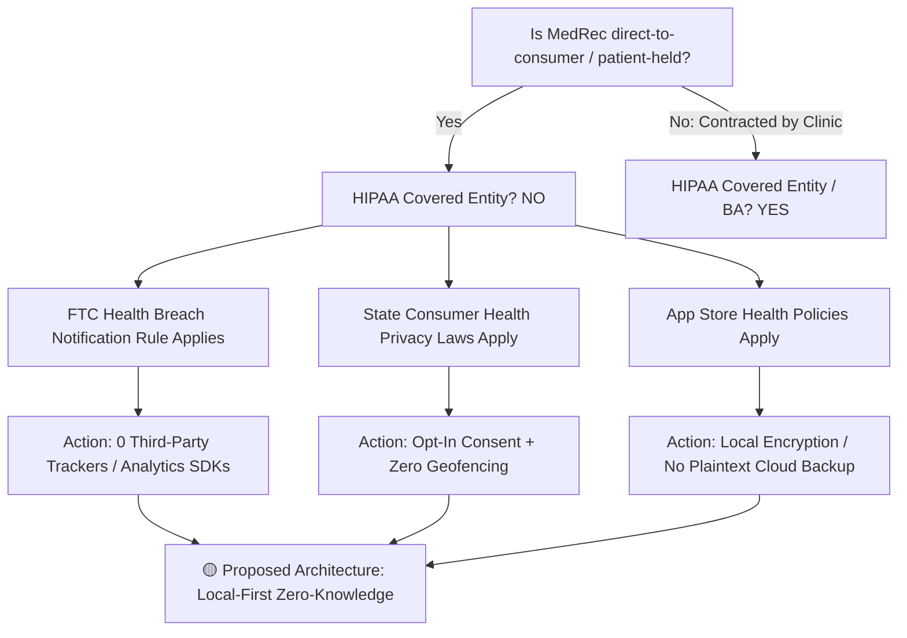

# Regulatory Landscape & Interoperability Standards

> [!NOTE]
> **Epistemic Status:** ⚪ `SECONDARY RESEARCH OBSERVATION` / 🟢 `CONFIRMED REGULATORY REQUIREMENTS`
> All statutory citations, rule numbers, and standards specifications below represent confirmed legal and technical standards as of 2026. Specific architectural implementations for [[MedRec]] are marked as 🟡 `PROPOSED COMPLIANCE ARCHITECTURE` and remain subject to formal legal review before production deployment.

This document compiles the regulatory frameworks, technical interoperability mandates, statutory patient data rights, and store-level compliance requirements that govern personal health records (PHRs) and health data exchange.

---

## 🛠️ Interoperability Standards

Healthcare data interoperability rests on several generations of formatting and transport standards:

```
┌───────────────────────────────────────────────────────────────────────────┐
│                        Interoperability Standards Stack                   │
├────────────────────────────────┬──────────────────────────────────────────┤
│ Modern RESTful APIs & Data     │ HL7 FHIR Release 4 (JSON / XML)          │
│ App Launch & Auth Profiles     │ SMART on FHIR (OAuth 2.0 + OpenID Connect)│
│ Medical Imaging                │ DICOM & DICOMweb (WADO-RS, QIDO-RS)      │
│ Document Exchange (Legacy)     │ C-CDA (Consolidated CDA XML)             │
│ Hospital Messaging (Legacy)    │ HL7 v2 (Pipe-delimited: ADT, ORU, MDM)    │
│ Federated Mobile Profiles      │ IHE (MHD, XCA, PIXm, PDQm)               │
└────────────────────────────────┴──────────────────────────────────────────┘
```

### 1. HL7 FHIR (Fast Healthcare Interoperability Resources) — Release 4
- **Specification Status:** 🟢 `CONFIRMED STANDARD` (Normative Baseline)
- **Mandate:** Mandated by the ONC (Office of the National Coordinator for Health IT) as the baseline for certified EHR technology (CEHRT).
- **Architecture:** Modular, RESTful APIs exchanging resources in JSON or XML format.
- **Core Resources Relevant to MedRec:**
  - `Patient`: Demographics, identifiers, contact information.
  - `Condition`: Diagnoses, problems, health concerns.
  - `Observation`: Vital signs, laboratory measurements, social history.
  - `MedicationRequest` / `MedicationStatement`: Active prescriptions, dosage instructions.
  - `AllergyIntolerance`: Documented drug/food/environmental allergies and adverse reactions.
  - `DocumentReference`: Pointers to clinical notes, PDFs, or scanned documents.
  - `DiagnosticReport`: Lab panels, radiology interpretations, pathology reports.
  - `Immunization`: Vaccine history and administration dates.
- **Key Advantage:** Granular resource querying via standard HTTP verbs (`GET /Observation?patient=123&category=vital-signs`).

### 2. HL7 v2 (Version 2.x)
- **Specification Status:** 🟢 `CONFIRMED STANDARD` (Legacy Workhorse)
- **Architecture:** Pipe-delimited (`|`, `^`, `~`) event-driven messaging developed in the late 1980s.
- **Prevalence:** Powers **80%+ of internal hospital workflows**, including Admission-Discharge-Transfer (`ADT`), lab orders/results (`ORM`/`ORU`), and billing.
- **Implication for MedRec:** Direct integration with raw HL7 v2 feeds is outside MedRec's consumer scope, but patient portal exports may derive from converted HL7 v2 messages.

### 3. C-CDA (Consolidated Clinical Document Architecture)
- **Specification Status:** 🟢 `CONFIRMED STANDARD` (Document-Level Standard)
- **Architecture:** XML-based clinical document markup defined under HL7 Version 3.
- **Usage:** Standard output behind the "Download My Health Summary" / "Blue Button" feature across major patient portals (Epic MyChart, Cerner HealtheLife).
- **Structure:** Encapsulates human-readable narrative text with machine-readable XML sections (Continuity of Care Document — `CCD`).
- **Implication for MedRec:** MedRec must support parsing and extracting discrete structured fields from imported C-CDA XML files (see [[Medical Records]]).

### 4. DICOM & DICOMweb
- **Specification Status:** 🟢 `CONFIRMED STANDARD` (Medical Imaging Standard)
- **Scope:** Storage, transmission, and rendering of medical images (CT scans, MRIs, X-rays, Ultrasounds).
- **DICOMweb REST Protocols:**
  - `WADO-RS` (Web Access to DICOM Objects): Retrieve image instances, frames, and bulk data via HTTP GET.
  - `QIDO-RS` (Query based on ID for DICOM Objects): Search studies, series, and instances via REST parameters.
  - `STOW-RS` (Store Over the Web by REST): Upload DICOM instances via multipart HTTP POST.
- **Implication for MedRec:** Large image payloads require dedicated zero-knowledge chunk storage and off-thread image rendering (see [[Data Encryption]]).

### 5. SMART on FHIR
- **Specification Status:** 🟢 `CONFIRMED STANDARD` (Auth & Integration Layer)
- **Architecture:** OAuth 2.0 authorization framework + OpenID Connect identity layer layered on top of FHIR endpoints.
- **Launch Modes:**
  - **Standalone Launch (Patient-Facing):** Patient launches MedRec, selects their hospital/provider, authenticates using their portal credentials, and grants MedRec scoped read permissions (`patient/*.read`).
  - **EHR Launch (Provider-Facing):** Clinician launches an integrated app within the EHR workflow (`launch/patient`).
  - **Backend Services:** Automated machine-to-machine sync using signed JWT assertions.
- **Relevance:** The primary mechanism for MedRec to execute automated, direct patient-authorized EHR sync without scraping portal credentials.

### 6. IHE (Integrating the Healthcare Enterprise) Profiles
- **Specification Status:** 🟢 `CONFIRMED STANDARD`
- **Profiles:**
  - `MHD` (Mobile access to Health Documents): RESTful interface mapping to FHIR `DocumentReference` and `Binary`.
  - `XCA` (Cross-Gateway Access): Query and retrieve records across organizational boundaries.
  - `PIXm` / `PDQm` (Patient Identifier Cross-referencing / Patient Demographics Query for Mobile): Lightweight mobile profiles for patient identity resolution.

---

## 🏛️ US Regulatory Framework

```
┌───────────────────────────────────────────────────────────────────────────┐
│                          US Regulatory Scope                              │
├──────────────────────────┬────────────────────────────────────────────────┤
│ Covered Entities & BAs   │ HIPAA Privacy & Security Rules (45 CFR § 164)   │
│ EHR Vendors & Providers  │ 21st Century Cures Act § 4004 (45 CFR Part 171)│
│ Certified Health IT      │ ONC HTI-1 Final Rule (USCDI v3, SMART v2)       │
│ Health Payers & Plans    │ CMS Interoperability Rules (CMS-9115-F / 0057-F)│
│ Direct-to-Consumer Apps  │ FTC Act § 5 & Health Breach Rule (16 CFR § 318)│
│ State Consumer Privacy   │ WA MHMDA, CA CMIA / CCPA, NV SB370, CT PA 23-56│
└──────────────────────────┴────────────────────────────────────────────────┘
```

### 1. HIPAA (Health Insurance Portability and Accountability Act of 1996)
- **Statutory Scope:** 45 CFR Parts 160, 162, and 164 (Privacy, Security, and Breach Notification Rules).
- **Jurisdictional Boundary:** Applies **ONLY** to:
  1. *Covered Entities* (healthcare providers, health plans, healthcare clearinghouses).
  2. *Business Associates* (vendors contracted by Covered Entities to process PHI on their behalf).
- **CRITICAL LEGAL DISTINCTION FOR MEDREC:**
  > [!IMPORTANT]
  > **Non-HIPAA Covered Status:** A standalone, direct-to-consumer mobile app where the **PATIENT directly downloads, imports, and stores their own health records** is **NOT a Covered Entity and NOT a Business Associate**.
  >
  > Once clinical records are transmitted by a Covered Entity to a patient-designated endpoint (such as MedRec via SMART on FHIR or manual download) under the patient's statutory right of access, **HIPAA protections terminate for that data**. The data is then governed by consumer protection law (FTC Act and state privacy statutes).

### 2. 21st Century Cures Act (Section 4004 / 45 CFR Part 171)
- **Statutory Scope:** Enacted December 2016; ONC Information Blocking Final Rule effective April 2021.
- **Information Blocking Prohibition (45 CFR § 171.103):** Healthcare providers, certified health IT developers, and health information networks (HINs) are legally prohibited from engaging in practices that are likely to interfere with, prevent, or materially discourage access, exchange, or use of electronic health information (EHI).
- **Enforcement & Penalties:**
  - EHR Vendors / Developers: Civil monetary penalties (CMPs) up to **$1,000,000 per violation** investigated by the HHS Office of Inspector General (OIG).
  - Healthcare Providers: Disincentives applied under CMS payment programs (MIPS, Medicare Promoting Interoperability).
- **Core Exceptions:** 8 narrow statutory exceptions (Preventing Harm, Privacy, Security, Infeasibility, Health IT Performance, Content & Manner, Licensing, Reasonable Fees).
- **Significance for MedRec:** Providers **cannot legally block or charge prohibitive fees** when a patient requests their records via certified FHIR APIs connected to third-party consumer apps.

### 3. ONC HTI-1 Rule (Health Data, Technology, and Interoperability: Certification Program Updates)
- **Statutory Scope:** Final rule published January 2024 by ONC (now ASTP - Assistant Secretary for Technology Policy).
- **Key Mandates:**
  - **USCDI v3 (United States Core Data for Interoperability):** Mandated baseline for all certified health IT by **January 1, 2026**. Adds critical data elements including clinical notes, laboratory result interpretations, and social determinants of health (SDOH).
  - **SMART App Launch v2:** Requires granular data scopes (allowing patients to consent to specific resources, e.g., sharing only `MedicationRequest` without exposing `Condition` or mental health notes).
  - **Public Endpoint Directories:** Certified developers must publish standardized, quarterly-updated public FHIR endpoint bundles, enabling MedRec to discover and connect to provider servers dynamically.
  - **Insights Condition:** Continuous reporting on API usage and patient query success rates.

### 4. CMS Interoperability Rules (CMS-9115-F & CMS-0057-F)
- **CMS-9115-F (2020 Interoperability and Patient Access Rule):**
  - Mandates Medicare Advantage, Medicaid State Agencies, and ACA Marketplace payers expose standard **Patient Access APIs** (FHIR R4) for claims, encounter, and clinical data.
- **CMS-0057-F (2024 Interoperability and Prior Authorization Rule):**
  - Enforcement timeline: Effective **January 1, 2027**.
  - Expands Patient Access API to include prior authorization decisions.
  - Mandates Provider Access APIs and Payer-to-Payer Data Exchange APIs.
- **Significance for MedRec:** Enables MedRec to pull insurance claims and cost data alongside clinical provider records.

### 5. FTC Health Breach Notification Rule (16 CFR Part 318, Amended 2024)
- **Statutory Scope:** Governs vendors of personal health records (PHRs) and PHR-related entities not covered by HIPAA.
- **2024 Final Amendments:**
  - **Expanded Definition of "Breach":** Expressly clarifies that unauthorized disclosure of sensitive health data to third-party tracking pixels, analytics SDKs, or advertising networks (e.g., Meta Pixel, Google Analytics) without affirmative express consent constitutes a **breach of security**.
  - **Notification Timeline:** Must notify consumers without unreasonable delay and in no case later than **60 calendar days** after discovery. If 500+ individuals are affected, must notify FTC within 10 business days.
  - **Penalties:** Civil penalties exceeding **$50,120 per violation per day** under Section 5 of the FTC Act.
- **Direct Requirement for MedRec:** MedRec must operate with **ZERO third-party advertising SDKs, ZERO tracking pixels, and STRICT local or zero-knowledge telemetry** to prevent catastrophic breach liabilities.

### 6. State Health Privacy Laws
- **California Confidentiality of Medical Information Act (CMIA) & CCPA/CPRA:**
  - CMIA requires records inspection within **5 business days** and paper/electronic copies within **15 calendar days** (substantially faster than HIPAA's 30-day window).
  - CPRA treats health data as "Sensitive Personal Information" requiring opt-out of sharing and strict data minimization.
- **Washington My Health My Data Act (MHMDA - RCW 19.373):**
  - Effective 2024; applies to any entity processing WA consumer health data.
  - Mandates **opt-in consent** for collecting, sharing, or selling consumer health data.
  - **Prohibits geofencing** around healthcare facilities.
  - Grants a **private right of action** allowing individual consumers to sue for violations.
- **Nevada SB 370 & Connecticut PA 23-56:** Similar heightened consumer health privacy frameworks.

---

## ⚖️ Patient Statutory Rights (US Jurisdiction)

```
┌───────────────────────────────────────────────────────────────────────────┐
│                      Patient Data Rights Summary                          │
├──────────────────────────┬────────────────────────────────────────────────┤
│ Legal Ownership of Media │ Provider / Facility holds physical/digital asset│
│ Right of Access & Copy   │ Statutory, unconditional right (45 CFR §164.524│
│ Right of Transmission    │ Unrestricted right to direct records to third  │
│ Cost via FHIR API        │ $0.00 (Mandated free of charge under Cures Act)│
│ Cost via Document Copy   │ Reasonable cost-based fee only (labor/media)   │
│ Turnaround: Digital API  │ Immediate / Real-time                          │
│ Turnaround: Formal Paper │ 30 days (Federal HIPAA) / 15 days (CA, TX, WA) │
└──────────────────────────┴────────────────────────────────────────────────┘
```

1. **Medium Ownership vs. Information Rights:**
   - The provider or hospital owns the physical server, paper chart, and database infrastructure.
   - However, the patient owns an **unconditional, federally enforceable legal right to inspect, copy, and transmit** all Designated Record Set (DRS) data under 45 CFR § 164.524.
2. **Format of Production:**
   - Under HIPAA and the Cures Act, the covered entity must provide the electronic record in the format requested by the patient if it is "readily producible" (FHIR JSON, C-CDA XML, or PDF).
3. **Fee Limitations:**
   - Access via automated FHIR API endpoints must be completely **free of charge**.
   - For manual file transfers, providers may only charge a reasonable, cost-based fee reflecting direct labor and electronic media costs; search and retrieval fees are strictly prohibited.

See detailed analysis in [[Patient Data Ownership]] and [[Delayed Healthcare Access]].

---

## 🌍 International Regulatory Frameworks

### 1. European Union — GDPR (General Data Protection Regulation, EU 2016/679)
- **Special Category Data (Article 9):** Processing of data concerning health is prohibited by default unless an explicit exception applies (Article 9(2)(a): explicit consent).
- **Right to Data Portability (Article 20):** Data subjects have the right to receive personal data in a structured, commonly used, and machine-readable format (`JSON`, `XML`) and transmit it to another controller without hindrance.
- **Mandatory Safeguards:**
  - Data Protection Impact Assessment (DPIA) required prior to processing (Article 35).
  - Data Protection Officer (DPO) appointment required if processing sensitive health data on a large scale (Article 37).
  - Privacy by Design and by Default (Article 25).

### 2. European Health Data Space (EHDS — Regulation EU 2025/327)
- **Status:** 🟢 `CONFIRMED REGULATION` (Entered into force March 2025; progressive implementation through 2027–2029).
- **Core Provisions:**
  - Mandates a standardized **European Electronic Health Record Exchange Format (EEHRxF)** built on HL7 FHIR and open specifications.
  - Grants European citizens direct, free, and real-time cross-border access to their electronic health records.
  - Establishes national digital health contact points (MyHealth@EU) for interoperable exchange across all EU member states.

---

## 📱 App Store & Ecosystem Health Data Policies

Both major platform holders enforce stringent, non-negotiable policies for apps interacting with health records:

### Apple App Store Review Guidelines (Section 5.1.3 - Health and Health Research)
- **No Unencrypted Health Data Storage:** Health, motion, and fitness data must not be stored in unencrypted or shared iCloud containers.
- **Strict Prohibition on Selling Data:** Apps may not sell or disclose health data to advertising platforms, data brokers, or information resellers.
- **Mandatory Usage Strings:** Must provide clear, explicit purpose strings in `Info.plist` (e.g., `NSHealthShareUsageDescription`, `NSFaceIDUsageDescription`).
- **HealthKit / Clinical Records Entitlement:** Access to Health Records APIs requires signed developer agreements and demonstrated compliance with FHIR standards.

### Google Play Store Health Apps Policy (Updated 2024/2025)
- **Health Apps Declaration:** Mandatory submission detailing data handling practices, regulatory status, and clinical affiliations.
- **Minimum Necessary Access:** Apps must request the narrowest possible permission scopes (e.g., Health Connect granular data types).
- **Prominent Disclosure & Consent:** Must provide an in-app privacy disclosure prior to requesting health data access; passive consent or burying disclosures in terms of service is grounds for removal.
- **No Advertising Use:** Health data cannot be used or disclosed for personalized or interest-based advertising.

---

## 🌲 What This Means for MedRec (Compliance Decision Tree)



### Confirmed Regulatory Requirements vs. Proposed Architecture

| Dimension | Confirmed Regulatory Requirement 🟢 | Proposed MedRec Architecture 🟡 |
| :--- | :--- | :--- |
| **HIPAA Scope** | MedRec as a patient-owned local vault is NOT a Covered Entity under 45 CFR § 160.103. | Operate strictly as an untethered, client-side personal health record; avoid acting as a Business Associate until enterprise tiers are developed. |
| **FTC Breach Rule** | Any third-party transmission of health data without explicit consent is a breach (16 CFR § 318). | Zero third-party trackers, zero advertising SDKs, local-only or strictly zero-knowledge telemetry. |
| **State Laws (WA/CA)** | Opt-in consent required for all collection; geofencing prohibited (WA MHMDA). | Granular, upfront consent screens with per-record import approval; no location harvesting. |
| **EHR Data Sync** | Providers cannot block FHIR API access (Cures Act 45 CFR Part 171). | Utilize SMART on FHIR Standalone Patient Launch using public certified endpoints. |
| **Data Storage** | Apple/Google policies prohibit plaintext health data in cloud sync. | Local-first encrypted SQLite database (SQLCipher) + end-to-end encrypted backup (see [[Data Encryption]]). |

---

## 🔗 Related Notes
- [[Data Privacy]]
- [[Data Encryption]]
- [[Security & Privacy MOC]]
- [[Authentication Architecture]]
- [[Research Questions]]
- [[Patient Data Ownership]]
- [[Medical Records]]
- [[Research MOC]]
