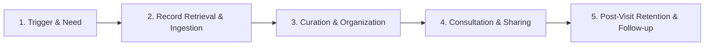

# User Journey

This document provides the foundational framework and empty template for mapping the end-to-end patient experience in MedRec. 

The complete journey map will be populated once primary user research has been conducted, charting the patient's path from the initial moment they encounter a need for their medical records, through collection, organization, and presentation to a healthcare provider.

## Purpose of User Journey Mapping in MedRec

- Visualize the emotional highs and lows of patients interacting with their health data.
- Identify the exact moments of highest friction mapped to [[User Pain Points]].
- Bridge qualitative user understanding into actionable product touchpoints and [[User Flow]] designs within [[Product Design MOC]].

## Journey Phases Overview

The patient journey is structured around five key lifecycle stages:

1. **Trigger & Need**: A life event occurs (moving, new chronic diagnosis, specialist referral, upcoming surgery) necessitating access to medical history.
2. **Record Retrieval & Ingestion**: Patient gathers physical paperwork, portal PDFs, lab results, and imports them into MedRec.
3. **Curation & Organization**: Patient reviews, tags, categorizes, and validates the imported data into a cohesive health timeline.
4. **Consultation & Sharing**: Patient arrives at the clinic or hospital and presents relevant records/summaries to the doctor.
5. **Post-Visit Retention & Follow-up**: Patient logs new findings, updates prescriptions, and stores the new visit records.

## Journey Map Template (To Be Populated Post-Research)

| Stage | Patient Goal | Touchpoint / Action | Emotional State | Key Friction & Pain Points | MedRec Opportunity |
| :--- | :--- | :--- | :--- | :--- | :--- |
| **1. Trigger & Need** | *TBD from research* | *TBD* | *Anxious / Uncertain* | *Fragmented past records* | Quick onboarding, clear value prop |
| **2. Ingestion** | *TBD from research* | *TBD* | *Frustrated / Overwhelmed* | *Incompatible formats, scanning paper* | OCR, batch upload, easy import |
| **3. Curation** | *TBD from research* | *TBD* | *Confused / Relieved* | *Medical jargon, unindexed files* | Auto-tagging, chronological timeline |
| **4. Consultation** | *TBD from research* | *TBD* | *Stressed / Prepared* | *Doctor has no time, portal locks* | Fast 1-page summary, temporary share link |
| **5. Retention** | *TBD from research* | *TBD* | *Empowered / Neutral* | *Forgetting new paperwork* | Rapid post-visit receipt capture |

## Next Steps

- Link finalized journey paths to validated profiles in [[User Personas]].
- Translate identified opportunities into detailed UX wireframes and [[User Flow]] diagrams.
