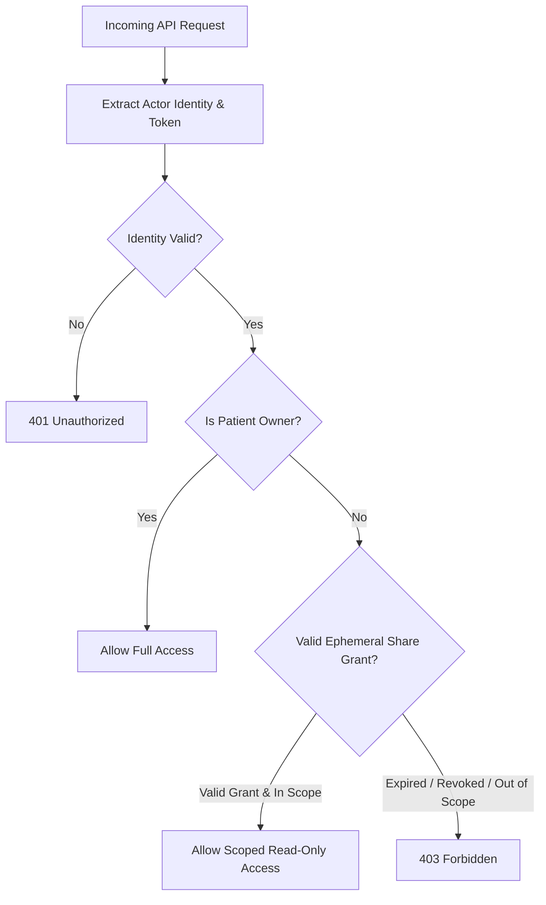

# Authorization Architecture

## Overview

The Authorization architecture governs who can perform which actions on which medical resources within MedRec. Unlike general consumer applications, healthcare data authorization requires strict **resource-level ownership checks** and support for **temporary, scoped delegation** to third-party practitioners.

## Core Authorization Principles

1. **Deny by Default**: Any request lacking an explicit, verifiable authorization policy grant is rejected.
2. **Resource-Level Ownership**: A patient account is the cryptographic and logical owner of their health records. Having a valid token does not grant access to another patient's data.
3. **Capability-Based Ephemeral Sharing**: Healthcare providers (doctors, lab technicians) receive temporary, time-bound, scoped capabilities (e.g. read-only access to a specific encounter or category for 1 hour) without creating full permanent accounts.

## Roles & Access Model

| Role | Scope | Permissions |
|---|---|---|
| **Patient (Owner)** | Own records only | Full CRUD on personal records, issue share grants, revoke grants, view audit trails, export data. |
| **Provider / Guest (Delegate)** | Explicitly shared records only | Read-only access within defined scope (e.g., specific date range, category) until expiration. |
| **System / Background** | System operations | Asynchronous AI pipeline processing, notification dispatch (strictly scoped, no arbitrary data access). |

## Policy Enforcement Architecture

- **Policy Enforcement Point (PEP)**: API middleware intercepting every request before routing to business logic handlers.
- **Policy Decision Point (PDP)**: Evaluation logic verifying:
  - `actor_id == record.user_id` (Owner check) OR
  - `active_grant(grant_token, record_id, current_timestamp) == true` (Delegate check).
- **Audit Integration**: Every authorization check (both successes and rejections) must emit an event to [[Audit Logs]].

## Assumptions & Hypotheses

- **Assumption**: Ephemeral token-based access (via QR codes) will satisfy 95%+ of doctor consultation workflows without requiring provider account registration.
- **Hypothesis**: Embedding fine-grained scopes (e.g., `scope: ["prescriptions:read", "labs:read"]`) into signed sharing tokens simplifies validation without heavy database joins on every read.
