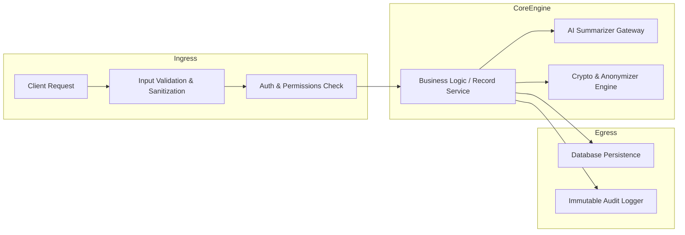

# Backend Architecture

## Overview

The MedRec backend service serves as the core orchestration engine responsible for business logic execution, data integrity, authorization enforcement, sensitive data encryption, and interfacing with external AI models.

The backend technology stack is **NOT YET SELECTED** and is being evaluated in [[Decision - Backend Technology]].

## Key Architectural Responsibilities

### 1. API & Business Logic Design
- Clean separation of concerns using a service-layer or domain-driven pattern.
- Strictly validated input payloads to protect against injection and malformed medical payloads.
- Asynchronous task handling for heavy workloads such as PDF text extraction, OCR processing, and AI summarization.

### 2. Medical Data Handling & Privacy
- **Zero-knowledge / Field-level Encryption**: Sensitive clinical fields (diagnoses, lab results, prescriptions) must be encrypted prior to persistence.
- **AI Context Sanitization**: When proxying data to external AI APIs, sensitive personal identifiers (PII: patient name, address, insurance numbers) must be stripped or masked.
- **Audit Logging**: Every read, export, or modification of a patient record must trigger an immutable audit entry ([[Audit Logs]]).

### 3. Scalability & Operational Simplicity
- As a solo developer, operational complexity must be minimized.
- Stateless service design allowing seamless vertical or horizontal scaling.
- Health checks, structured JSON logging, and standardized error responses.

## Current Hypotheses & Assumptions

- **Hypothesis**: Building a modular monolith in a modern typed language (e.g., TypeScript with Node.js/Fastify, or Python with FastAPI, or Go) will provide the optimal balance of developer velocity and type safety.
- **Assumption**: Asynchronous background jobs for AI processing and PDF parsing will prevent API timeouts on mobile clients.

## Related Decision Notes

- [[Decision - Backend Technology]] (Evaluating Node.js/TypeScript vs Python/FastAPI vs Go)
