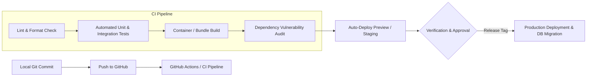

# Deployment Strategy

## Overview

The deployment strategy defines how MedRec code moves safely from local development to production environments. For a solo project, automation is essential: manual deployment steps lead to human error, missed migrations, and operational stress.

The exact deployment pipeline and tooling are currently **TBD**.

## Core Deployment Principles

1. **Continuous Integration (CI)**:
   - Every pull request and push to `main` must automatically execute linter, type checks, and automated test suites ([[Testing]]).
   - Build artifacts only if all checks pass.
2. **Predictable Database Migrations**:
   - Schema migrations must run as a pre-deploy or release step before the new application version begins serving traffic.
   - Backward-compatible schema evolution to prevent downtime.
3. **Environment Isolation**:
   - Strict separation between `Development`, `Staging / Preview`, and `Production` environments.
   - Separate database instances and storage buckets for each environment to prevent accidental data corruption or leakage.
4. **Zero-Downtime & Rollback Readiness**:
   - Rolling updates or blue/green deployments supported by container orchestration.
   - One-click rollback capability to previous stable container images.

## Mobile Application Release Pipeline

- **Staging / Internal Testing**: Automated builds distributed via TestFlight (iOS) and Google Play Internal App Sharing (Android).
- **Fastlane / CI Integration**: Automate certificate signing, version incrementing, and build uploads to reduce manual overhead.

## Assumptions & Hypotheses

- **Assumption**: GitHub Actions provides sufficient free/low-cost CI/CD minutes to cover all automated testing and deployment for MedRec.
- **Hypothesis**: Containerizing backend services via Docker will ensure absolute parity between local development and cloud production.
