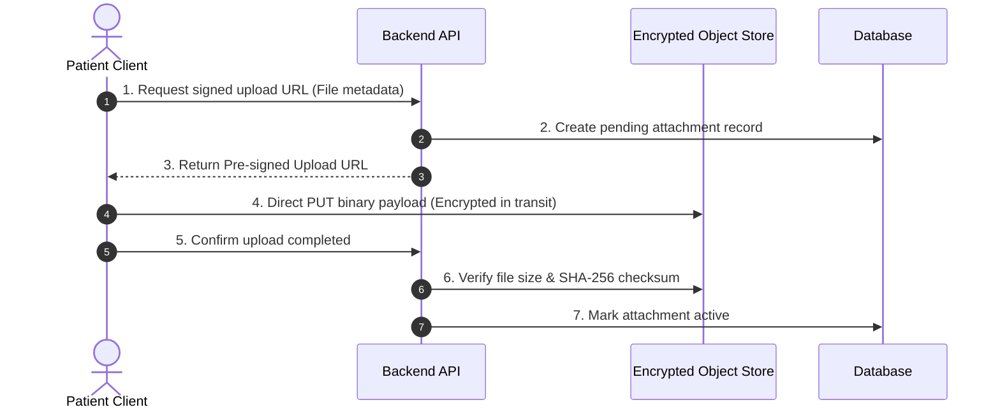

# File Storage Architecture

## Overview

Medical records often originate as binary documents: scanned lab result sheets, PDF specialist letters, X-ray / ultrasound image files, and discharge summaries. Storing large binary objects directly within a relational or document database degrades database performance and complicates backups. MedRec requires a dedicated, secure, and cost-effective file storage architecture.

The file storage provider is **NOT YET SELECTED** and will be determined alongside [[Cloud Infrastructure]].

## Architectural Considerations

### 1. Pre-Signed URL Workflow
- To avoid bottlenecking the backend server with heavy upload/download streams, clients interact directly with object storage via time-limited, cryptographically signed URLs (e.g. AWS S3 Presigned URLs, GCS Signed URLs, or Supabase Storage URLs).

### 2. Encryption at Rest & in Transit
- All binary payloads must be encrypted during upload/download over TLS 1.3.
- Server-Side Encryption with customer-managed or cloud KMS keys (e.g. AES-256) is mandatory.
- Option to evaluate client-side envelope encryption before upload for maximum zero-knowledge privacy.

### 3. Access Control & Scoped Delivery
- File objects must never be publicly readable (`private` bucket ACLs).
- Pre-signed download URLs generated for authorized viewing sessions should have very short time-to-live (e.g., 5 to 15 minutes).
- When a doctor views records through a temporary share grant, download URLs are restricted strictly to records within that grant's scope.

### 4. Cost & Scalability for a Solo Developer
- Cost predictability is critical. S3-compatible alternatives (Cloudflare R2 with zero egress fees, Backblaze B2, or Supabase Storage) are strong candidates for evaluation.
- Quota management per user to avoid unexpected storage cost spikes.

## Assumptions & Hypotheses

- **Assumption**: Average medical attachment size will be 1–5 MB (mostly PDFs and smartphone photos of physical lab printouts).
- **Hypothesis**: Using Cloudflare R2 or AWS S3 with pre-signed URLs will reduce server memory pressure to near zero during large file uploads.
