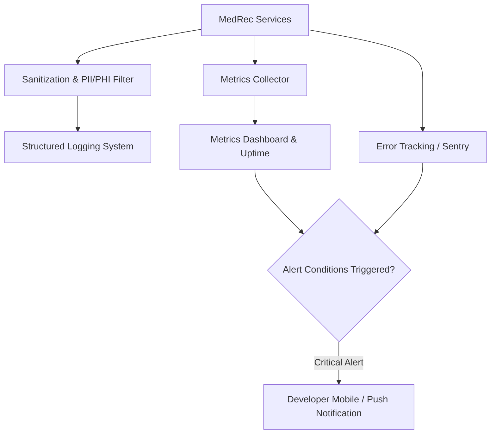

# System Monitoring & Observability

## Overview

Observability is essential to maintain high reliability, track performance bottlenecks, and rapidly identify bugs or security anomalies. However, in a medical records application, monitoring introduces a distinct challenge: **system telemetry and error logs must strictly avoid capturing Protected Health Information (PHI) or user credentials**.

The specific monitoring stack and alerting tools are currently **TBD**.

## Observability Pillars

### 1. Application Logging
- **Structured JSON Logs**: All logs emit structured JSON with standard fields (`timestamp`, `level`, `requestId`, `service`, `durationMs`, `statusCode`).
- **Strict PHI Masking**: Automatic sanitization middleware to scrub request bodies, query params, and headers for sensitive medical fields, passwords, and tokens before writing to log streams.
- **Separation from Audit Logs**: Operational/debug logs are distinct from compliance [[Audit Logs]]. Audit logs track business access events; system logs track runtime health.

### 2. Metrics & Performance
- **Key Indicators (SLIs)**:
  - HTTP request rate, 5xx/4xx error rates, p95 and p99 response latencies.
  - Database connection pool saturation and query execution times.
  - Background AI job queue latency and failure rates.
  - Storage upload/download throughput.

### 3. Error Tracking & Crash Reporting
- Client-side and server-side crash reporting (e.g. Sentry or GlitchTip) configured with strict data scrubbing rules.
- Real-time exception notifications for unhandled errors.

### 4. Synthetic Health Checks & Uptime Alerting
- Public health endpoint (`/healthz` and `/readyz`) verifying database and storage connectivity.
- External ping monitors (e.g. Better Uptime, UptimeRobot) with SMS/push alerts.

## Hypotheses & Assumptions

- **Hypothesis**: Adopting an open-source or lightweight monitoring tool (e.g., Sentry for errors + Grafana Cloud / Better Uptime for metrics) will provide enterprise-grade observability without heavy maintenance burden for a solo developer.
- **Assumption**: Scrubbing request payloads at the logging middleware level will prevent accidental PHI ingestion into third-party monitoring vendors.
