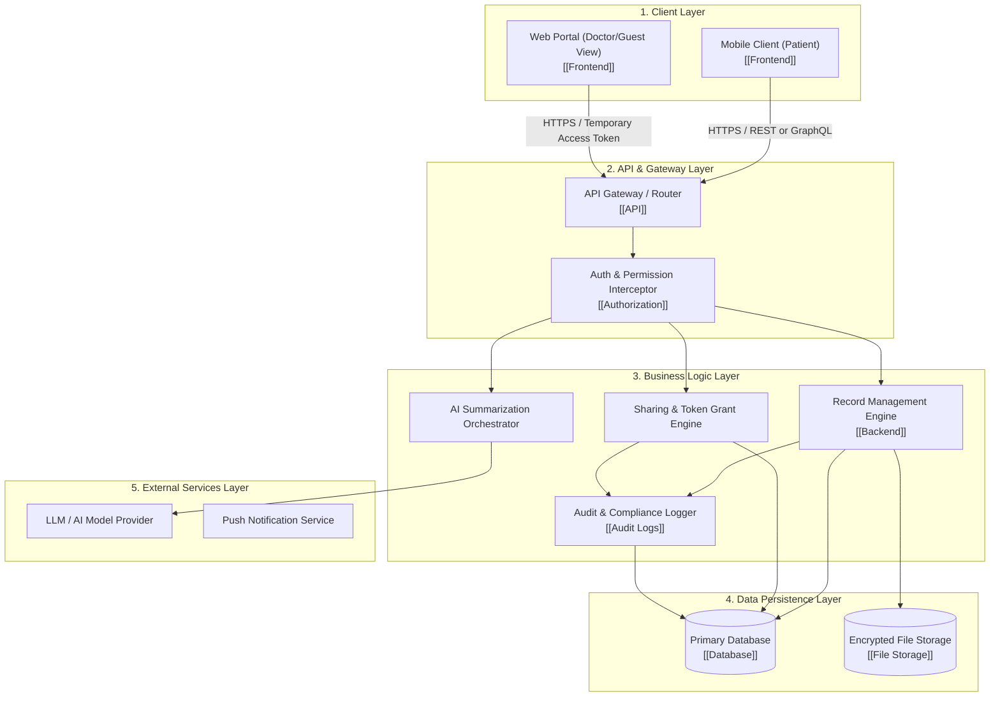

# System Architecture

## Overview

This document outlines the high-level structural design and layered decomposition for the MedRec application. The architecture follows a multi-tier client-server model designed to isolate concerns, enforce strict data access boundaries, and allow independent evolution of each subsystem.

Specific technology selections for all layers are currently **TBD** and being evaluated.

## System Layers (Templates & Specifications)

### 1. Client Layer
- **Purpose**: Deliver an intuitive, responsive, and secure interface for patients and temporary healthcare providers.
- **Components**:
  - **Patient App**: Primary interface for uploading records, viewing AI summaries, and managing sharing permissions.
  - **Guest/Doctor View**: Lightweight web interface accessed via QR code or shared link for reviewing time-limited shared records.
- **Status**: TBD (See [[Frontend]] and [[Decision - Frontend Technology]]).

### 2. API & Gateway Layer
- **Purpose**: Single point of ingress, routing, transport security termination (TLS), request rate-limiting, and authentication validation.
- **Components**:
  - Request router and input validation middleware.
  - Authentication token verification ([[Authentication Architecture]]).
  - Authorization policy enforcement point ([[Authorization]]).
- **Status**: TBD (See [[API]] and [[Decision - API Style]]).

### 3. Business Logic Layer
- **Purpose**: Core application logic, business rules, access control checks, and workflow coordination.
- **Components**:
  - **Record Service**: Validates, tags, indexes, and organizes medical records.
  - **Sharing Service**: Issues signed, expiring access tokens and generates QR codes for clinical sharing sessions.
  - **AI Adapter Service**: Prepares anonymized or sanitized context, interfaces with external AI APIs, and processes structured summaries.
  - **Audit Logger**: Asynchronously records all data access and export actions into immutable audit logs.
- **Status**: TBD (See [[Backend]] and [[Decision - Backend Technology]]).

### 4. Data Persistence Layer
- **Purpose**: Durable, ACID-compliant, encrypted persistence for structured entities, metadata, and unstructured medical documents.
- **Components**:
  - **Primary Relational / Document Store**: User accounts, record metadata, sharing grants, audit trails.
  - **Encrypted Object Storage**: PDF lab reports, medical scans, imaging files.
- **Status**: TBD (See [[Database]], [[Database Schema]], and [[File Storage]]).

### 5. External Services Layer
- **Purpose**: Third-party integration points for non-core capabilities.
- **Components**:
  - **AI Model APIs**: For text simplification, clinical summarization, and categorizing lab metrics.
  - **Notification Systems**: Alerts for record access events and sharing expirations.
- **Status**: TBD.

## Architectural Assumptions & Hypotheses

- **Assumption**: Healthcare providers will prefer opening a browser link or scanning a QR code over installing a native mobile app.
- **Hypothesis**: Decoupling the AI adapter into an isolated service module will allow switching LLM vendors or hosting local models without altering core record business logic.
- **Assumption**: Storing file attachments in dedicated object storage with pre-signed URLs reduces backend bandwidth requirements.
