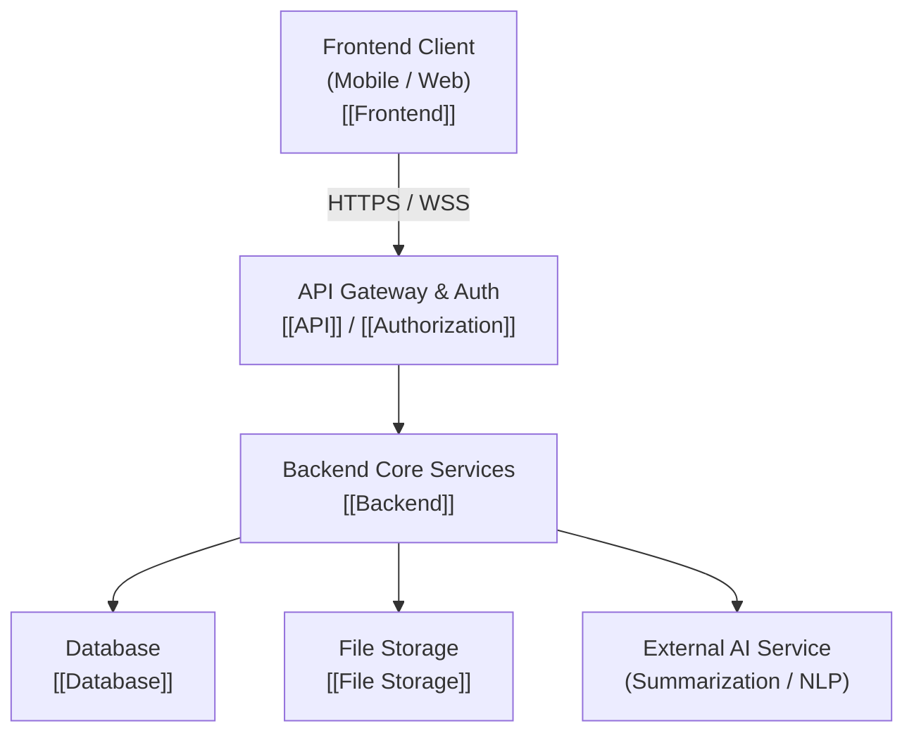

# Technical Architecture

## Overview

This note captures the top-level technical architecture overview for **MedRec**, a personal health records management and portability application. As a solo developer building a privacy-critical application, my technical architecture must balance simplicity, developer velocity, robust security, and maintainability.

The technical architecture is currently in the **early planning and proposed stage**. No final technology stack decisions have been locked in yet.

## Guiding Architectural Principles

1. **Privacy & Security by Design**: Medical records are sensitive personal data. Zero-trust principles, end-to-end transport encryption, and granular authorization must be baked into every layer rather than patched on later.
2. **Solo Developer Maintainability**: I need to avoid over-engineering. Monolithic or modular-monolith structures are preferred over microservices until scale demands otherwise.
3. **Data Portability & Patient Ownership**: Architecture must support easy import, export, and temporary delegable access (via QR codes or tokens).
4. **Resilience & Offline Awareness**: Critical patient records (like emergency contacts, allergies, and recent prescriptions) should ideally be accessible even under poor connectivity.

## Core Architectural Subsystems

- **[[System Architecture]]**: High-level structural breakdown and component interaction model.
- **[[Frontend]]**: Client-side application layer. Cross-platform mobile vs web considerations. (Open decision: [[Decision - Frontend Technology]]).
- **[[Backend]]**: Server-side business logic, data validation, and AI orchestration. (Open decision: [[Decision - Backend Technology]]).
- **[[API]]**: Interface contract between clients and backend services. (Open decision: [[Decision - API Style]]).
- **[[Database]]**: Primary data persistence for users, metadata, categories, and audit logs. (Open decision: [[Decision - Database Choice]]).
- **[[File Storage]]**: Secure storage for binary medical files (PDFs, lab scans, images).
- **[[Cloud Infrastructure]]**: Cloud hosting, compute, networking, and secrets management.
- **[[Deployment]]**: CI/CD pipelines, containerization, and release workflow.
- **[[Monitoring]]**: Health checks, observability, and structured logging without PHI leakage.

## Current Hypotheses & Assumptions

- **Hypothesis**: A single unified backend API service handling auth, records CRUD, and AI proxying will provide the fastest development cycle and lowest operational overhead for a solo project.
- **Assumption**: A mobile-first frontend will meet 90%+ of primary patient use cases during clinic visits.
- **Assumption**: File storage should be decoupled from the primary database to handle large imaging files and PDFs cost-effectively.

## Open Technical Decisions

- [[Decision - Frontend Technology]] (Flutter vs React Native vs Native)
- [[Decision - Backend Technology]] (Node.js/Express/FastAPI/Go)
- [[Decision - Database Choice]] (PostgreSQL vs MongoDB vs SQLite)
- [[Decision - API Style]] (REST vs GraphQL)
- [[Decision - Cloud Provider]] (AWS vs GCP vs Supabase vs Render/Fly.io)

## Next Steps

1. Clarify functional requirements and data shapes via [[Database Schema]].
2. Research regulatory baseline requirements in [[Security & Privacy MOC]].
3. Conduct technical evaluation spikes for the open decision notes.
