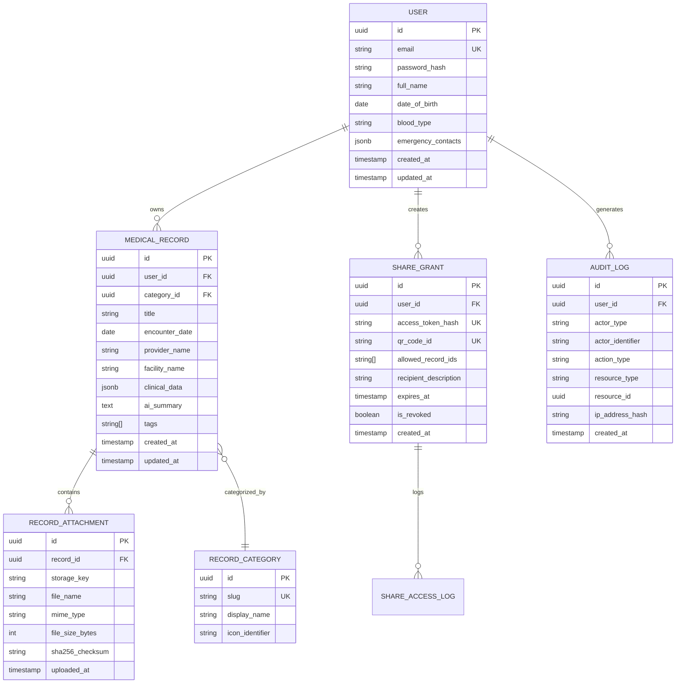

# Database Schema

## Overview

This note provides the conceptual entity-relationship blueprint for MedRec. Detailed physical database schemas, data types, indexes, and migration scripts will be finalized once the underlying database technology is selected in [[Decision - Database Choice]].

## Conceptual Entity Relationship Model

## Schema Entities (Planned Specifications)

### 1. `users` / [[User Profile]]
- Identity, credentials hash, profile demographics, emergency medical card info, and security preferences.

### 2. `medical_records` / [[Medical Records]]
- Core clinical record entries. Includes structured fields (dates, facility, doctor) and flexible payload (diagnoses, prescriptions, vitals, lab numbers) plus AI-generated summaries.

### 3. `record_categories` / [[Medical Record Categories]]
- Taxonomy for organizing records (e.g. Consultations, Lab Tests, Prescriptions, Imaging, Vaccinations, Surgeries).

### 4. `record_attachments`
- Metadata pointers to binary files stored securely in [[File Storage]].

### 5. `share_grants`
- Ephemeral tokens, permissions scope, expiration timestamps, and revocation flags for doctor sharing sessions.

### 6. `audit_logs` / [[Audit Logs]]
- Immutable event records tracking every data access, modification, export, and sharing event.

## Open Design Questions

- How will field-level encryption affect indexing on searchable medical record attributes?
- Should AI summaries be stored alongside records or in a dedicated versioned table?
- Migration and schema evolution strategy when adding new medical domain types.
