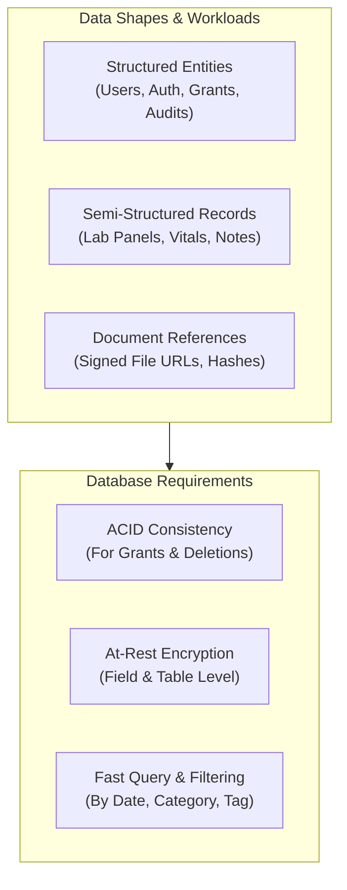

# Database Architecture

## Overview

The persistence layer for MedRec must reliably store, index, and secure sensitive medical records, user profiles, access grants, and audit events. Medical data exhibits both highly structured properties (user profiles, medication dosages, encounter dates, share token expirations) and semi-structured or polymorphic properties (lab panels, diagnostic reports, physician notes).

The primary database technology is **NOT YET SELECTED** and is being evaluated in [[Decision - Database Choice]].

## Key Database Considerations

### 1. Data Modeling & Shape
- **Relational vs Document vs Hybrid**:
  - Relational (e.g., PostgreSQL with JSONB) provides strong schema validation, referential integrity for access tokens and audit logs, and rich indexing on semi-structured medical payloads.
  - Document Store (e.g., MongoDB) provides flexible document schemas matching polymorphic health data models but requires application-level integrity enforcement.
- **Entity Separation**: Clear boundaries between user identity data, clinical record content, and temporal sharing tokens.

### 2. Query Patterns & Access Characteristics
- High read frequency on timeline/history views (filtering by date, medical category, prescribing physician).
- Heavy search requirement across clinical notes, medication names, and diagnoses.
- Fast token validation lookups with automatic expiration indexing (TTL indexes or indexed timestamps).

### 3. Security, Encryption & Compliance
- Transparent Data Encryption (TDE) at rest.
- Column-level / field-level encryption for designated PHI attributes.
- Strict isolation by tenant / user ID to prevent cross-user data leakage.

## Hypotheses & Assumptions

- **Hypothesis**: PostgreSQL with JSONB columns offers the best hybrid approach—providing strict relational integrity for auth, users, and audit logs while allowing flexible schemas for diverse medical record types.
- **Assumption**: As a solo developer, using an ORM or query builder (e.g., Prisma, Drizzle, SQLAlchemy) with automatic schema migrations will minimize runtime bugs.

## Related Decision Notes

- [[Decision - Database Choice]] (Evaluating PostgreSQL vs MongoDB vs Supabase/SQLite)
- [[Database Schema]] (Entity relational diagrams and proposed table specifications)
