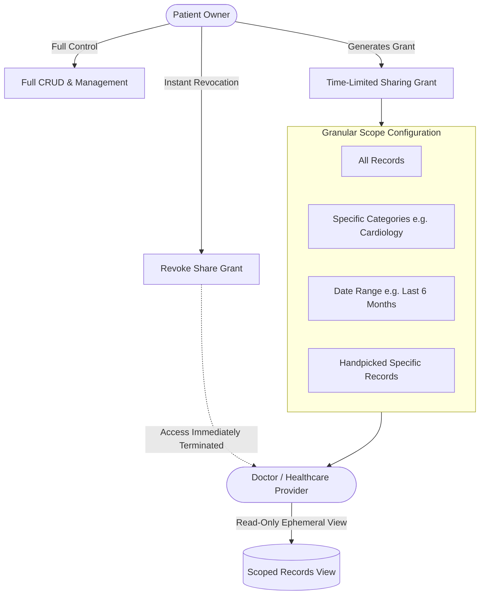

# Access Control Model

## Overview

The Access Control Model defines the boundary rules and permission semantics determining how users, healthcare providers, and external systems interact with health data in MedRec. The fundamental principle is **Patient Sovereignty**: the patient holds absolute control over who views their records, what specific records are exposed, and for how long.



## Core Access Control Dimensions

### 1. Patient Ownership (Primary Access)
- The authenticated patient has full read, write, update, export, and delete capabilities over all records they have created or imported.
- No other user can search, discover, or query a patient's records without an active sharing grant.

### 2. Provider & Clinical Delegation (Secondary Access)
- **Zero Provider Account Prerequisite**: Doctors do not need an account to view records; access is mediated via high-entropy access tokens embedded in QR codes or secure links ([[Record Sharing]]).
- **Read-Only Enforced**: Provider access grants are strictly read-only. Providers cannot edit, overwrite, or delete patient records.
- **Granular Scoping**:
  - *Full History*: All records shared.
  - *Category-Based*: Only records in selected categories (e.g., Cardiology, Laboratory).
  - *Date-Restricted*: Only encounters within a specified timeframe (e.g., last 30 days).
  - *Single Record*: A specific lab result or prescription only.

### 3. Temporal Constraints & Revocation
- **Mandatory Expiration**: Every share grant requires a time-to-live (TTL), ranging from 15 minutes to 72 hours (default: 1 hour).
- **Instant Revocation**: Patients can terminate any active sharing session with one tap, invalidating all associated tokens immediately.
- **Access Limits**: Optional max-view count (e.g., grant expires after 3 opens).

## Access Evaluation Logic

```text
ALLOW request IF:
  (actor.id == record.owner_id)
  OR
  (
    actor.token == grant.token
    AND grant.is_revoked == false
    AND current_timestamp < grant.expires_at
    AND record.id IN grant.allowed_record_ids
    AND request.method == "GET"
  )
ELSE:
  DENY and EMIT audit_event("UNAUTHORIZED_ACCESS_ATTEMPT")
```

## Hypotheses & Assumptions

- **Hypothesis**: Patients will feel substantially safer sharing records with new doctors if they can explicitly exclude sensitive categories (e.g., mental health, reproductive health) from general consultations.
- **Assumption**: A simple 1-hour expiration default aligns with the typical duration of an outpatient clinic visit.
