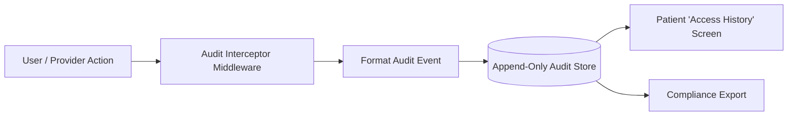

# Audit Logging & Access Transparency

## Overview

In medical applications, audit logging is both a strict regulatory requirement (HIPAA § 164.312(b), GDPR Article 30) and a core privacy feature for patients. Patients must have total visibility into **who accessed their medical records, when they accessed them, which specific documents were viewed, and whether data was downloaded or exported**.



## Logged Events & Categories

Every interaction with sensitive data generates an append-only audit record:

| Event Category | Trigger Events | Required Metadata |
|---|---|---|
| **Authentication** | Login, Logout, MFA Attempt, Password Change, Failed Login | Timestamp, User ID, IP Hash, Device / User-Agent |
| **Record Access** | Record Detail Viewed, Document PDF Opened / Downloaded | Timestamp, Record ID, Patient ID, Actor Type (Self vs Doctor) |
| **Record Modification** | Record Created, Updated, Archived, Deleted | Timestamp, Record ID, Change Summary, Author ID |
| **Sharing Lifecycle** | Share Grant Created, QR Generated, Grant Revoked, Doctor Session Opened | Timestamp, Grant ID, Token Hash, Recipient Description, Expiration |
| **Data Export** | Full Medical Export (JSON/PDF/ZIP) | Timestamp, Patient ID, Export Scope, Checksum |

## Audit Log Record Structure

Each audit entry must be immutable (write-once, never updated or deleted except under strict compliance retention rules):

```json
{
  "audit_id": "aud_01HZX89...",
  "timestamp": "2026-08-24T06:50:00Z",
  "patient_id": "usr_9871...",
  "actor": {
    "type": "ephemeral_provider",
    "grant_id": "grnt_4421...",
    "label": "Dr. Smith Clinic Visit",
    "ip_hash": "e3b0c442...",
    "user_agent": "Mozilla/5.0..."
  },
  "action": "RECORD_VIEW",
  "resource": {
    "type": "medical_record",
    "id": "rec_3301...",
    "category": "cardiology"
  },
  "status": "SUCCESS"
}
```

## Security & Privacy Considerations for Audit Logs

1. **Immutability & Integrity**: Audit records must be stored in append-only tables or write-once object storage to prevent tampering.
2. **No PHI in Audit Logs**: Audit events record *metadata* (IDs, timestamps, categories) but never raw clinical notes or diagnoses.
3. **Patient-Facing Audit Dashboard**: Patients can open an "Activity Log" in the app to verify every doctor who scanned their QR code.

## Hypotheses & Assumptions

- **Hypothesis**: Showing real-time notifications ("Dr. Clinic opened your Lab Results 2 minutes ago") gives patients high psychological safety and trust in the platform.
- **Assumption**: Hashing client IP addresses preserves privacy while maintaining security forensic capability.
