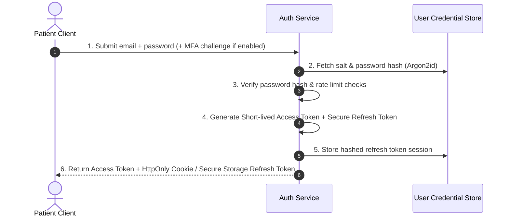

# Authentication Architecture

> [!NOTE]
> This document specifies the underlying **security architecture** and technical mechanisms of authentication. For the user-facing feature requirements and user experience, see [[Authentication]].

## Overview

Authentication verifies the cryptographic identity of users (patients and administrators) before permitting access to health data. In MedRec, weak authentication directly endangers patient privacy. The authentication architecture must defend against credential stuffing, brute-force attacks, session hijacking, and token theft.

The underlying authentication framework and library implementation are **NOT YET DECIDED** and are currently in the proposed design phase.

## Core Security Mechanisms

### 1. Password Hashing & Storage
- **Algorithm**: State-of-the-art memory-hard hashing (Argon2id preferred; bcrypt as standard fallback).
- **Salting**: Unique cryptographically secure random salt per user record.
- **Pepper**: Optional server-side pepper stored separately in secret manager.

### 2. Token & Session Strategy
- **Short-Lived Access Tokens**: JWT (JSON Web Token) or lightweight signed token valid for 10–15 minutes.
- **Rotating Refresh Tokens**: Stored securely on client (Keychain/Keystore on mobile; HttpOnly SameSite Strict cookie on web). Each refresh rotation invalidates the prior refresh token.
- **Session Revocation**: Centralized session revocation list allowing immediate logout across all devices or on password change.

### 3. Multi-Factor Authentication (MFA / 2FA)
- Time-based One-Time Password (TOTP via Authenticator apps like Google Authenticator, 1Password, Aegis).
- WebAuthn / Passkeys for hardware-backed biometric authentication on modern smartphones.
- SMS-based 2FA discouraged due to SIM-swapping vulnerabilities.

### 4. Abuse & Brute-Force Protection
- Account lockout policy / progressive exponential delays after consecutive failed attempts.
- Global and IP-based rate limiting on `/auth/login`, `/auth/register`, and `/auth/reset-password`.
- CAPTCHA or proof-of-work challenge on anomalous registration traffic.

## Hypotheses & Assumptions

- **Hypothesis**: Utilizing short-lived access tokens (15 min) paired with single-use rotating refresh tokens offers the best compromise between stateless backend scalability and rapid revocation capability.
- **Assumption**: Biometric local app unlocking (Face ID / Fingerprint) will satisfy daily user convenience while full re-authentication is required for critical actions (e.g. exporting all records, changing credentials).
