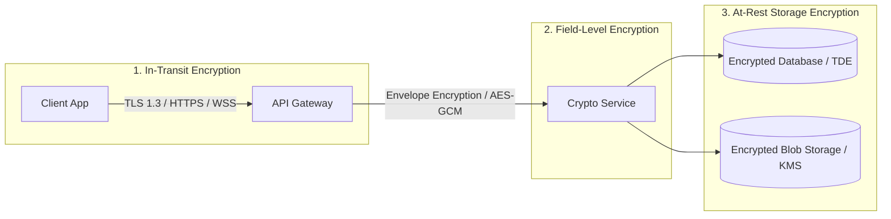

# Data Encryption

## Overview

Data encryption forms the core defense mechanism protecting sensitive medical records from unauthorized access, interception, or physical data theft. Because MedRec manages Protected Health Information (PHI) and Personally Identifiable Information (PII), end-to-end encryption principles must be applied across all operational stages: **in-transit**, **at-rest**, and potentially **application-layer / field-level**.

Specific cryptographic implementations and key management strategies are currently **under research** to align with healthcare data security standards.

## Encryption Domains

### 1. Encryption in Transit
- **Requirement**: Mandatory TLS 1.3 (with fallback to TLS 1.2 minimum; older SSL/TLS versions disabled).
- **HSTS**: Strict Transport Security headers enforced across all domains with preloading.
- **Certificate Management**: Automated certificate rotation via Let's Encrypt / Cloudflare / AWS Certificate Manager.
- **Client Pinning (Research Item)**: Investigating SSL pinning for mobile apps to prevent man-in-the-middle (MitM) attacks on compromised networks.

### 2. Encryption at Rest
- **Storage Layer**: Transparent volume and disk encryption (AES-256) for database storage instances and file attachment buckets.
- **Backup Encryption**: All automated database snapshots and offsite archive dumps must be encrypted using separate keys before storage.

### 3. Application / Field-Level Encryption (CLE / FLE)
- **Concept**: Even if the primary database is compromised or read via SQL injection, sensitive clinical fields (diagnoses, lab values, prescriptions) remain unreadable without application keys.
- **Techniques Under Evaluation**:
  - Authenticated symmetric encryption (AES-256-GCM or ChaCha20-Poly1305).
  - Envelope encryption with Customer Master Keys (CMK) managed via Cloud KMS (AWS KMS / GCP KMS / HashiCorp Vault).

## Research Questions & Healthcare Standards

- [ ] *Research*: What are the mandatory encryption standards under HIPAA Security Rule (45 CFR § 164.312(a)(2)(iv) and § 164.312(e)(2)(ii)) and GDPR Article 32?
- [ ] *Research*: What is the performance overhead of application-layer field encryption on mobile search and indexing?
- [ ] *Research*: How should key rotation be structured for a solo developer without introducing severe operational fragility?

## Hypotheses & Assumptions

- **Hypothesis**: Standard TLS 1.3 in-transit plus managed cloud database TDE (Transparent Data Encryption) will satisfy baseline security, but field-level encryption for clinical notes provides necessary defense-in-depth against insider threats.
- **Assumption**: AES-256-GCM is the industry gold standard for symmetric authenticated data encryption.
