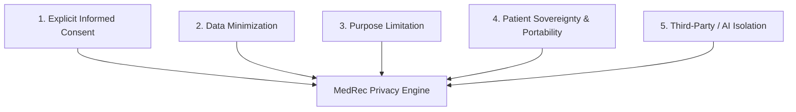

# Data Privacy & Governance

## Overview

Data privacy is the foundation of user trust in MedRec. Unlike general consumer applications, medical information touches on deeply intimate personal history. Privacy must not merely be a legal disclaimer; it must be implemented as architectural constraints embedded in the software.

This area is currently **under active research** to establish compliance baselines and operational protocols.

## Core Privacy Principles

### 1. Explicit Informed Consent
- No silent telemetry, no third-party tracking scripts, no behavioral ad SDKs.
- Granular consent for AI-assisted features (e.g. "Do you want AI to summarize this lab report?").
- Clear disclosure of how data is processed, stored, and temporarily shared.

### 2. Data Minimization
- Collect and store *only* the minimum information required to deliver functionality.
- Optional fields should always remain optional (e.g. profile photos, social demographics).
- Strip unnecessary EXIF metadata from uploaded medical photos (GPS coordinates, camera serial numbers).

### 3. Third-Party AI Data Isolation
- When medical record text is sent to LLM APIs for summarization or simplification:
  - Strict zero-data-retention (ZDR) agreements must be active.
  - User medical data must **never** be used for model training or fine-tuning.
  - Personal Identifiers (name, date of birth, phone, SSN/ID) must be sanitized prior to external API transmission.

## Regulatory Landscape Under Research

- **HIPAA (Health Insurance Portability and Accountability Act)**:
  - *Context*: US healthcare regulations governing Covered Entities and Business Associates.
  - *Research Need*: Is a direct-to-consumer Personal Health Record (PHR) app classified as a Business Associate, or regulated under the FTC Health Breach Notification Rule?
- **GDPR (General Data Protection Regulation)**:
  - *Context*: European Union data privacy laws treating health data as "Special Category Data" (Article 9).
  - *Research Need*: Requirements for explicit consent, Data Protection Impact Assessment (DPIA), and right to erasure.
- **Local / Regional Health Privacy Standards**:
  - Researching regional medical records privacy laws (e.g. Canada PIPEDA, Philippines DPA 2012).

## Research Questions

- [ ] *Research*: What legal agreements (BAAs or ZDR enterprise terms) are required with LLM vendors (OpenAI, Anthropic) to handle medical text responsibly?
- [ ] *Research*: How should emergency medical access (e.g., ICE contacts) be balanced with strict privacy defaults?

## Hypotheses & Assumptions

- **Hypothesis**: Adopting GDPR's strict "privacy-by-design" standard will provide a robust baseline that satisfies most regional healthcare privacy expectations worldwide.
- **Assumption**: Patients will gladly use AI features if they have explicit confirmation that their data will not be used to train AI models.
