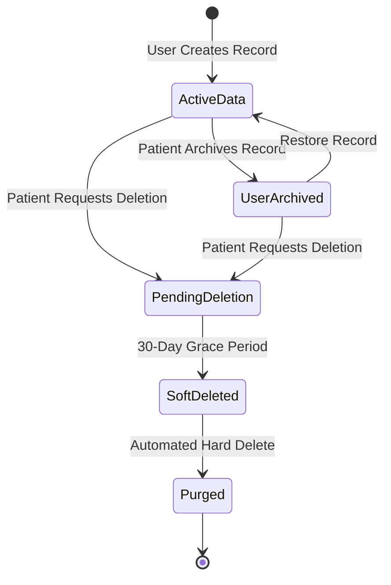

# Data Retention & Deletion Policies

## Overview

Medical records possess unique retention requirements. While institutional healthcare providers (hospitals, clinics) are legally mandated by health authorities to retain patient medical charts for minimum statutory periods (e.g., 5 to 10 years depending on jurisdiction), a **patient-owned Personal Health Record (PHR)** operates under user-sovereign control. Patients must retain the fundamental right to manage, archive, or permanently purge their data.

The exact regulatory distinctions and implementation mechanisms are currently **under research**.

## Retention & Deletion Policy Dimensions

### 1. Patient-Initiated Record Deletion
- **Granular Deletion**: Patients can delete individual records, lab files, or prescriptions at any time.
- **Account Termination ("Right to be Forgotten")**:
  - Full account deletion requests initiate a 30-day grace period (soft-delete), after which all personal records, files, and profile details are permanently purged from active databases and object storage.
  - Option for users to bypass grace period with explicit password/MFA confirmation for immediate hard delete.

### 2. Ephemeral Share Grants & Tokens
- **Automatic Pruning**: Expired share tokens and QR codes are automatically deactivated upon expiry and permanently purged from active lookup indexes after 90 days.
- **Revocation**: Manually revoked grants are marked invalid immediately.

### 3. Binary File & Document Purging
- When a medical record attachment is deleted, the corresponding object in [[File Storage]] must be securely deleted via storage API to avoid orphaned storage costs and residual data risk.

### 4. Audit Log Retention
- Audit logs ([[Audit Logs]]) tracking access history must be preserved for compliance and user transparency (e.g., 1 to 3 years) even after records are updated, but must be cryptographically anonymized if the parent user account is permanently deleted.

## Research Questions & Regulatory Analysis

- [ ] *Research*: How do international privacy frameworks (GDPR Art. 17 "Right to Erasure" vs HIPAA record retention mandates) apply to a direct-to-consumer mobile health record app?
- [ ] *Research*: What are the technical best practices for purging deleted user data from encrypted database backups and immutable WAL logs?
- [ ] *Research*: How long should ephemeral doctor session logs be retained for patient safety review?

## Hypotheses & Assumptions

- **Hypothesis**: Giving patients a two-tier deletion model (30-day soft-delete recoverable from trash, followed by cryptographic wipe) prevents accidental data loss from mistaken taps while honoring privacy rights.
- **Assumption**: As a personal health record app, MedRec is not subject to hospital-mandated 7-year chart retention laws, provided patients retain full autonomous control.
