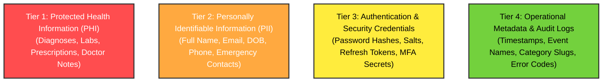

# Sensitive Data Classification

## Overview

To implement effective security and access controls, MedRec categorizes all application data into clear sensitivity tiers. Treating every piece of data according to its specific risk profile allows for appropriate encryption, logging, retention, and masking policies.

## Data Classification Matrix

| Tier | Category | Examples | Protection Requirements |
|---|---|---|---|
| **Tier 1** | **Protected Health Information (PHI)** | Clinical diagnoses, lab test results, medication lists & dosages, doctor notes, medical imaging PDFs/photos, surgical history. | • Field-level encryption • Zero external transmission without sanitization • Granular patient sharing controls • Comprehensive audit logging on access |
| **Tier 2** | **Personally Identifiable Information (PII)** | User full name, email address, date of birth, phone number, national health ID, emergency contact details. | • At-rest database encryption • Masking in application telemetry • User-directed export and deletion |
| **Tier 3** | **Authentication & Security Data** | Argon2/bcrypt password hashes, salt keys, session refresh tokens, TOTP secrets, share grant token hashes. | • Never stored in plaintext • Hardware-backed or KMS encryption • Excluded from all general backups and exports |
| **Tier 4** | **System & Audit Metadata** | Access timestamps, HTTP status codes, latency metrics, category taxonomies, event action tags. | • Anonymized / IP-hashed • Append-only storage • Scrubbed of PHI and PII |

## Handling Rules by Context

### 1. In Application Logging & Telemetry
- **Strict Prohibition**: Tier 1, Tier 2, and Tier 3 data must NEVER appear in server logs, crash reports (Sentry), or analytics events.
- Automatic payload sanitizers must redact parameters matching sensitive keys (`password`, `token`, `diagnosis`, `medication`, `notes`, `dob`).

### 2. In AI Prompt Construction
- Tier 1 medical data passed to LLMs must be stripped of Tier 2 identifiers (Name, Email, Phone, IDs) to ensure anonymized processing.
- Tier 3 data is never passed to AI services under any circumstances.

### 3. In Doctor Sharing Sessions
- Patients choose which Tier 1 records are exposed in an ephemeral share.
- Tier 3 credentials and unrelated Tier 1 records remain strictly inaccessible to the viewing doctor.

## Conclusions

- Establishing this four-tier taxonomy early ensures that database schemas, API serializers, and logging filters are engineered with precise protection rules from day one.
