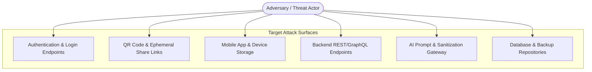

# Threat Model (STRIDE Methodology)

## Overview

A structured threat model identifies potential security risks, adversary capabilities, attack surfaces, and defensive mitigations across MedRec. By systematically analyzing threats early in development, security controls can be designed directly into the system architecture rather than patched reactively.

This model is currently in the **proposed design and template stage**, to be expanded iteratively as technical implementations solidify.

## Threat Model Matrix (Template & Baseline Assessment)

### 1. Key Assets to Protect
- **Patient Health Data (PHI)**: Diagnoses, lab reports, medications, physician notes ([[Sensitive Data]]).
- **Identity & Credentials**: Password hashes, JWTs, refresh tokens, biometric keys.
- **Sharing Channels**: Ephemeral share tokens, QR code URLs, and session access states.
- **Audit Logs**: Immutable records of access events ([[Audit Logs]]).

### 2. Threat Actors Under Consideration
- **Untrusted Third Parties / Internet Attackers**: Script kiddies, credential-stuffing botnets, automated vulnerability scanners.
- **Compromised Provider Devices**: Malicious software or unauthorized staff on clinic computers scanning QR codes.
- **Physical Device Thieves**: Individuals stealing an unlocked patient smartphone.
- **Rogue / Insecure Third-Party Services**: Compromised cloud hosting or AI vendor endpoints.

### 3. STRIDE Threat Analysis & Proposed Mitigations

| STRIDE Category | Potential Threat Scenario | Target Surface | Proposed Mitigations |
|---|---|---|---|
| **Spoofing Identity** | Attacker guesses/steals patient credentials or forges JWT tokens to impersonate patient. | Auth Endpoints | • Argon2id password hashing • MFA / Passkey support • Cryptographically signed JWTs with short expiry (15m) • Rate limiting & IP throttling |
| **Tampering with Data** | Attacker alters prescription records or modifies doctor share grant scopes in flight. | API / Database | • TLS 1.3 encryption in transit • Request signature verification • Field-level HMAC validation • Append-only audit logging |
| **Repudiation** | Doctor or patient denies accessing or exporting sensitive records. | Sharing & Export | • Immutable audit logging of all view/export events • Cryptographic token binding |
| **Information Disclosure** | Interception of QR code links; leakage of PHI via unmasked error logs or AI prompts. | Logs, AI Gateway, QR Links | • Time-limited share tokens (max 1h) • Instant patient revocation • Automated PHI scrubbing in logs & AI prompts • HTTPS only with HSTS |
| **Denial of Service (DoS)** | Attacker floods upload endpoints with massive PDF files or spamming AI summarization. | File Storage, AI API | • Strict file size limits (e.g. 10MB max) • Pre-signed URL quota controls • API rate limiting and AI request concurrency caps |
| **Elevation of Privilege** | Guest doctor viewing one shared record attempts IDOR to access patient's entire history. | API Authorization | • Strict server-side resource-level permission checks (`grant.record_ids.includes(target_id)`) • Deny by default |

## Open Threat Modeling Tasks

- [ ] Finalize threat scenarios for mobile app local cache when device is rooted / jailbroken.
- [ ] Model risk scenarios for AI hallucination presenting inaccurate clinical summaries to users.
- [ ] Define physical security guidance for QR code display in crowded clinic waiting rooms.
