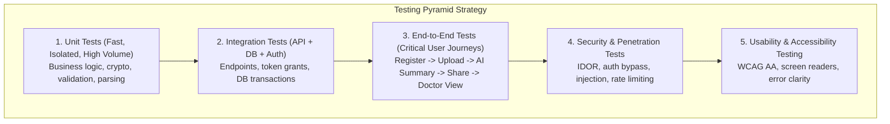

# Testing Strategy

## Overview

In a healthcare application, software bugs and security flaws can lead to clinical misinterpretation, data loss, or privacy breaches. As a solo developer, relying on manual testing is untenable. MedRec requires an automated, robust, and pragmatic testing strategy that delivers maximum confidence with manageable maintenance overhead.

The specific testing frameworks and test suites are currently **proposed and TBD** based on the final stack choices.

## Testing Levels & Planned Scope

### 1. Unit Testing
- **Focus**: Pure functions, data models, sanitization utilities, cryptographic helpers, and AI prompt formatting.
- **Key Targets**:
  - Validation schemas (date formats, dosage strings, MIME types).
  - Cryptographic wrappers (encryption/decryption, HMAC verification).
  - AI response parsers (ensuring graceful handling of malformed LLM outputs).
- **Target Coverage**: High coverage (>85%) on security and validation utilities.

### 2. Integration Testing
- **Focus**: API route handlers, database query interactions, middleware pipelines, and third-party service adapters.
- **Key Targets**:
  - Auth flows (registration, login, refresh token rotation, logout).
  - Record CRUD operations with tenant isolation checks.
  - Ephemeral sharing token creation, expiration enforcement, and instant revocation.
  - File upload pre-signed URL generation and verification.

### 3. End-to-End (E2E) Testing
- **Focus**: Complete user journeys tested across the client and backend.
- **Critical Golden Path Scenarios**:
  1. *Patient Onboarding*: Sign up $\rightarrow$ verify email $\rightarrow$ enable biometric lock $\rightarrow$ setup basic medical profile.
  2. *Record Management & AI*: Upload lab PDF $\rightarrow$ trigger AI summary $\rightarrow$ verify generated summary is displayed $\rightarrow$ edit record tags.
  3. *Clinical Sharing*: Patient generates QR code with 1-hour expiry $\rightarrow$ Simulated doctor browser opens link $\rightarrow$ views scoped records $\rightarrow$ Patient taps revoke $\rightarrow$ Doctor page immediately loses access.

### 4. Security & Vulnerability Testing
- **Automated Static Analysis (SAST)**: Automated linter rules and dependency vulnerability scanners (e.g. `npm audit`, `snyk`, `trivy`) in CI.
- **IDOR / Access Control Validation**: Specific test suite dedicated to attempting unauthorized cross-patient data access to verify boundary enforcement.
- **Input Fuzzing**: Testing API routes against SQL injection, XSS payloads, and malformed binary uploads.

### 5. Usability & Accessibility Testing
- Manual and automated accessibility audits (Lighthouse / axe-core) verifying WCAG 2.1 AA compliance.
- Testing high-contrast mode, large text scaling, and offline fallback screens.

## Hypotheses & Assumptions

- **Hypothesis**: Prioritizing integration tests over extensive frontend UI unit tests will provide higher confidence per hour of developer effort for a solo project.
- **Assumption**: Automating IDOR tests in the CI pipeline is the single most effective automated safeguard against medical record data leakage.
