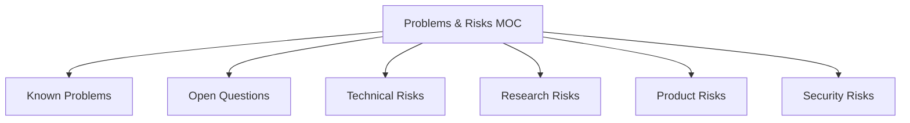

# Problems & Risks MOC

Master index of identified risks, active bugs/blockers, uncertainties, and domain challenges facing **MedRec**. As a personal project in the highly regulated and complex healthcare domain, acknowledging risks early and maintaining clear visibility into open questions is critical.

---

## 🗺️ Risk & Problem Domains

---

## 🧭 Navigation Catalog

### 1. 🔍 Identified Issues & Questions
- **[[Known Problems]]** — Active bugs, observed operational defects, and concrete system issues (currently minimal in early research).
- **[[Open Questions]]** — Foundational unknowns, regulatory ambiguities, and architectural questions needing answers.

### 2. ⚠️ Anticipated Risk Registries
- **[[Technical Risks]]** — Complexity around healthcare data interoperability, proprietary EHR formats, offline cryptographic key sync, and large medical imaging files.
- **[[Security Risks]]** — Threats regarding sensitive protected health information (PHI), data breaches, unauthorized sharing access, and compliance mandates.
- **[[Product Risks]]** — Usability hurdles, patient adoption barriers, clinical workflow mismatch, and competitive landscape friction.
- **[[Research Risks]]** — Scarcity of qualitative interview candidates, skewed research cohorts, and broad literature review scope.

---

## 🛡️ Risk Mitigation Philosophy for MedRec

> [!NOTE]
> - **Distinguish Reality from Assumption**: Clearly label whether an issue is an *observed fact*, a *research finding*, or an *anticipated risk* / *working hypothesis*.
> - **Fail Fast via Spikes**: Prototype high-risk technical unknowns (e.g., local encryption, OCR extraction) before committing to full architecture.
> - **Security Over Convenience**: When in doubt between rapid product shipping and health data privacy, always bias toward patient data sovereignty and client-side encryption &rarr; [[Security & Privacy MOC]].
