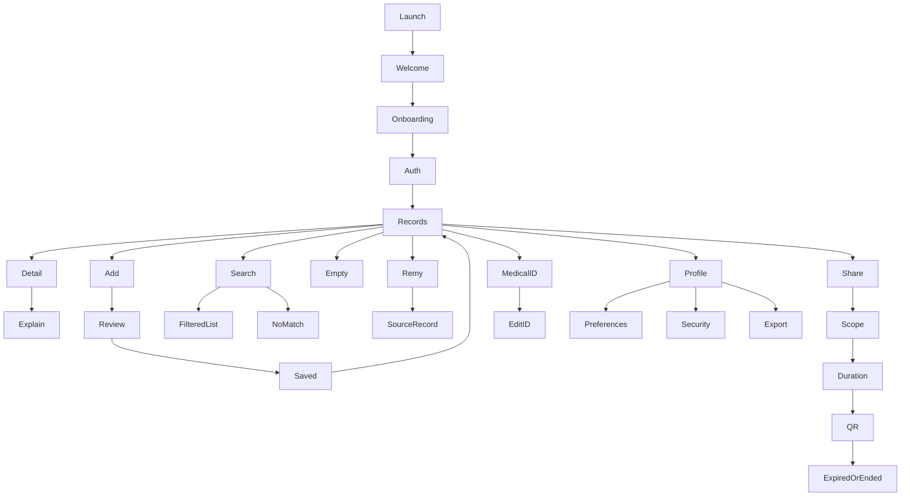

# Screen and route map

52 current Figma screen/state/overlay references. File names are stable semantic keys. Figma labels with “03” are legacy names on current nodes, not the deleted old design. A state is not necessarily a separate app route. All app paths below are relative to `apps/mobile/`.

| Family | Key | PNG | SVG | Current Figma node | Existing route / integration |
|---|---|---|---|---|---|
| Start and onboarding | `launch` | [View](figma-export/screens/png/launch.png) | [View](figma-export/screens/svg/launch.svg) | [75:2580](https://www.figma.com/design/ejP1MZ0Bzaqxzc31vgo5Bi/Personal-Projects?node-id=75-2580) | app/index.tsx + app/_layout.tsx; launch/session routing |
| Start and onboarding | `welcome` | [View](figma-export/screens/png/welcome.png) | [View](figma-export/screens/svg/welcome.svg) | [71:15717](https://www.figma.com/design/ejP1MZ0Bzaqxzc31vgo5Bi/Personal-Projects?node-id=71-15717) | app/index.tsx + app/_layout.tsx; launch/session routing |
| Start and onboarding | `onboarding-records` | [View](figma-export/screens/png/onboarding-records.png) | [View](figma-export/screens/svg/onboarding-records.svg) | [71:16885](https://www.figma.com/design/ejP1MZ0Bzaqxzc31vgo5Bi/Personal-Projects?node-id=71-16885) | app/onboarding.tsx, app/tour.tsx, src/screens/Onboarding.tsx |
| Start and onboarding | `onboarding-understand` | [View](figma-export/screens/png/onboarding-understand.png) | [View](figma-export/screens/svg/onboarding-understand.svg) | [71:16944](https://www.figma.com/design/ejP1MZ0Bzaqxzc31vgo5Bi/Personal-Projects?node-id=71-16944) | app/onboarding.tsx, app/tour.tsx, src/screens/Onboarding.tsx |
| Start and onboarding | `onboarding-share` | [View](figma-export/screens/png/onboarding-share.png) | [View](figma-export/screens/svg/onboarding-share.svg) | [71:16986](https://www.figma.com/design/ejP1MZ0Bzaqxzc31vgo5Bi/Personal-Projects?node-id=71-16986) | app/onboarding.tsx, app/tour.tsx, src/screens/Onboarding.tsx |
| Start and onboarding | `onboarding-medical` | [View](figma-export/screens/png/onboarding-medical.png) | [View](figma-export/screens/svg/onboarding-medical.svg) | [71:17032](https://www.figma.com/design/ejP1MZ0Bzaqxzc31vgo5Bi/Personal-Projects?node-id=71-17032) | app/onboarding.tsx, app/tour.tsx, src/screens/Onboarding.tsx |
| Start and onboarding | `sign-in` | [View](figma-export/screens/png/sign-in.png) | [View](figma-export/screens/svg/sign-in.svg) | [71:16466](https://www.figma.com/design/ejP1MZ0Bzaqxzc31vgo5Bi/Personal-Projects?node-id=71-16466) | app/(auth)/sign-in.tsx, register.tsx, code.tsx, forgot.tsx; respective auth state |
| Start and onboarding | `register` | [View](figma-export/screens/png/register.png) | [View](figma-export/screens/svg/register.svg) | [71:17901](https://www.figma.com/design/ejP1MZ0Bzaqxzc31vgo5Bi/Personal-Projects?node-id=71-17901) | app/(auth)/sign-in.tsx, register.tsx, code.tsx, forgot.tsx; respective auth state |
| Start and onboarding | `verify` | [View](figma-export/screens/png/verify.png) | [View](figma-export/screens/svg/verify.svg) | [71:16508](https://www.figma.com/design/ejP1MZ0Bzaqxzc31vgo5Bi/Personal-Projects?node-id=71-16508) | app/(auth)/sign-in.tsx, register.tsx, code.tsx, forgot.tsx; respective auth state |
| Start and onboarding | `resent` | [View](figma-export/screens/png/resent.png) | [View](figma-export/screens/svg/resent.svg) | [71:17959](https://www.figma.com/design/ejP1MZ0Bzaqxzc31vgo5Bi/Personal-Projects?node-id=71-17959) | app/(auth)/sign-in.tsx, register.tsx, code.tsx, forgot.tsx; respective auth state |
| Start and onboarding | `recovery` | [View](figma-export/screens/png/recovery.png) | [View](figma-export/screens/svg/recovery.svg) | [71:17965](https://www.figma.com/design/ejP1MZ0Bzaqxzc31vgo5Bi/Personal-Projects?node-id=71-17965) | app/(auth)/sign-in.tsx, register.tsx, code.tsx, forgot.tsx; respective auth state |
| Records and intake | `loading` | [View](figma-export/screens/png/loading.png) | [View](figma-export/screens/svg/loading.svg) | [75:2604](https://www.figma.com/design/ejP1MZ0Bzaqxzc31vgo5Bi/Personal-Projects?node-id=75-2604) | app/(tabs)/index.tsx; list/filter/loading/sheet state |
| Records and intake | `records` | [View](figma-export/screens/png/records.png) | [View](figma-export/screens/svg/records.svg) | [71:15759](https://www.figma.com/design/ejP1MZ0Bzaqxzc31vgo5Bi/Personal-Projects?node-id=71-15759) | app/(tabs)/index.tsx; list/filter/loading/sheet state |
| Records and intake | `labs` | [View](figma-export/screens/png/labs.png) | [View](figma-export/screens/svg/labs.svg) | [71:16621](https://www.figma.com/design/ejP1MZ0Bzaqxzc31vgo5Bi/Personal-Projects?node-id=71-16621) | app/(tabs)/index.tsx; list/filter/loading/sheet state |
| Records and intake | `consultations` | [View](figma-export/screens/png/consultations.png) | [View](figma-export/screens/svg/consultations.svg) | [71:17527](https://www.figma.com/design/ejP1MZ0Bzaqxzc31vgo5Bi/Personal-Projects?node-id=71-17527) | app/(tabs)/index.tsx; list/filter/loading/sheet state |
| Records and intake | `prescriptions` | [View](figma-export/screens/png/prescriptions.png) | [View](figma-export/screens/svg/prescriptions.svg) | [71:17645](https://www.figma.com/design/ejP1MZ0Bzaqxzc31vgo5Bi/Personal-Projects?node-id=71-17645) | app/(tabs)/index.tsx; list/filter/loading/sheet state |
| Records and intake | `imaging` | [View](figma-export/screens/png/imaging.png) | [View](figma-export/screens/svg/imaging.svg) | [71:17755](https://www.figma.com/design/ejP1MZ0Bzaqxzc31vgo5Bi/Personal-Projects?node-id=71-17755) | app/(tabs)/index.tsx; list/filter/loading/sheet state |
| Records and intake | `categories` | [View](figma-export/screens/png/categories.png) | [View](figma-export/screens/svg/categories.svg) | [71:17931](https://www.figma.com/design/ejP1MZ0Bzaqxzc31vgo5Bi/Personal-Projects?node-id=71-17931) | app/(tabs)/index.tsx; list/filter/loading/sheet state |
| Records and intake | `empty` | [View](figma-export/screens/png/empty.png) | [View](figma-export/screens/svg/empty.svg) | [71:16557](https://www.figma.com/design/ejP1MZ0Bzaqxzc31vgo5Bi/Personal-Projects?node-id=71-16557) | app/(tabs)/index.tsx; list/filter/loading/sheet state |
| Records and intake | `no-match` | [View](figma-export/screens/png/no-match.png) | [View](figma-export/screens/svg/no-match.svg) | [71:16723](https://www.figma.com/design/ejP1MZ0Bzaqxzc31vgo5Bi/Personal-Projects?node-id=71-16723) | app/(tabs)/index.tsx; list/filter/loading/sheet state |
| Records and intake | `record` | [View](figma-export/screens/png/record.png) | [View](figma-export/screens/svg/record.svg) | [71:15854](https://www.figma.com/design/ejP1MZ0Bzaqxzc31vgo5Bi/Personal-Projects?node-id=71-15854) | app/record/[id].tsx; detail/attachment/AI state |
| Records and intake | `original` | [View](figma-export/screens/png/original.png) | [View](figma-export/screens/svg/original.svg) | [71:17920](https://www.figma.com/design/ejP1MZ0Bzaqxzc31vgo5Bi/Personal-Projects?node-id=71-17920) | app/record/[id].tsx; detail/attachment/AI state |
| Records and intake | `explain` | [View](figma-export/screens/png/explain.png) | [View](figma-export/screens/svg/explain.svg) | [71:15904](https://www.figma.com/design/ejP1MZ0Bzaqxzc31vgo5Bi/Personal-Projects?node-id=71-15904) | app/record/[id].tsx; detail/attachment/AI state |
| Records and intake | `summary` | [View](figma-export/screens/png/summary.png) | [View](figma-export/screens/svg/summary.svg) | [71:17484](https://www.figma.com/design/ejP1MZ0Bzaqxzc31vgo5Bi/Personal-Projects?node-id=71-17484) | app/summary.tsx |
| Records and intake | `add` | [View](figma-export/screens/png/add.png) | [View](figma-export/screens/svg/add.svg) | [71:15947](https://www.figma.com/design/ejP1MZ0Bzaqxzc31vgo5Bi/Personal-Projects?node-id=71-15947) | app/add.tsx + src/add/*; intake/review/result/error state |
| Records and intake | `review` | [View](figma-export/screens/png/review.png) | [View](figma-export/screens/svg/review.svg) | [71:16000](https://www.figma.com/design/ejP1MZ0Bzaqxzc31vgo5Bi/Personal-Projects?node-id=71-16000) | app/add.tsx + src/add/*; intake/review/result/error state |
| Records and intake | `saved` | [View](figma-export/screens/png/saved.png) | [View](figma-export/screens/svg/saved.svg) | [71:16047](https://www.figma.com/design/ejP1MZ0Bzaqxzc31vgo5Bi/Personal-Projects?node-id=71-16047) | app/add.tsx + src/add/*; intake/review/result/error state |
| Records and intake | `upload-error` | [View](figma-export/screens/png/upload-error.png) | [View](figma-export/screens/svg/upload-error.svg) | [71:16789](https://www.figma.com/design/ejP1MZ0Bzaqxzc31vgo5Bi/Personal-Projects?node-id=71-16789) | app/add.tsx + src/add/*; intake/review/result/error state |
| Sharing | `share` | [View](figma-export/screens/png/share.png) | [View](figma-export/screens/svg/share.svg) | [71:16084](https://www.figma.com/design/ejP1MZ0Bzaqxzc31vgo5Bi/Personal-Projects?node-id=71-16084) | app/(tabs)/share.tsx; sessions/expired/revoked state |
| Sharing | `share-setup` | [View](figma-export/screens/png/share-setup.png) | [View](figma-export/screens/svg/share-setup.svg) | [71:16153](https://www.figma.com/design/ejP1MZ0Bzaqxzc31vgo5Bi/Personal-Projects?node-id=71-16153) | app/share/new.tsx + src/ui/ShareCard.tsx; scope/duration/receipt/copy state |
| Sharing | `share-single` | [View](figma-export/screens/png/share-single.png) | [View](figma-export/screens/svg/share-single.svg) | [71:17080](https://www.figma.com/design/ejP1MZ0Bzaqxzc31vgo5Bi/Personal-Projects?node-id=71-17080) | app/share/new.tsx + src/ui/ShareCard.tsx; scope/duration/receipt/copy state |
| Sharing | `share-all` | [View](figma-export/screens/png/share-all.png) | [View](figma-export/screens/svg/share-all.svg) | [71:17181](https://www.figma.com/design/ejP1MZ0Bzaqxzc31vgo5Bi/Personal-Projects?node-id=71-17181) | app/share/new.tsx + src/ui/ShareCard.tsx; scope/duration/receipt/copy state |
| Sharing | `setup-30` | [View](figma-export/screens/png/setup-30.png) | [View](figma-export/screens/svg/setup-30.svg) | [71:17282](https://www.figma.com/design/ejP1MZ0Bzaqxzc31vgo5Bi/Personal-Projects?node-id=71-17282) | app/share/new.tsx + src/ui/ShareCard.tsx; scope/duration/receipt/copy state |
| Sharing | `setup-60` | [View](figma-export/screens/png/setup-60.png) | [View](figma-export/screens/svg/setup-60.svg) | [71:17383](https://www.figma.com/design/ejP1MZ0Bzaqxzc31vgo5Bi/Personal-Projects?node-id=71-17383) | app/share/new.tsx + src/ui/ShareCard.tsx; scope/duration/receipt/copy state |
| Sharing | `qr` | [View](figma-export/screens/png/qr.png) | [View](figma-export/screens/svg/qr.svg) | [71:16207](https://www.figma.com/design/ejP1MZ0Bzaqxzc31vgo5Bi/Personal-Projects?node-id=71-16207) | app/share/new.tsx + src/ui/ShareCard.tsx; scope/duration/receipt/copy state |
| Sharing | `qr-single` | [View](figma-export/screens/png/qr-single.png) | [View](figma-export/screens/svg/qr-single.svg) | [71:17134](https://www.figma.com/design/ejP1MZ0Bzaqxzc31vgo5Bi/Personal-Projects?node-id=71-17134) | app/share/new.tsx + src/ui/ShareCard.tsx; scope/duration/receipt/copy state |
| Sharing | `qr-all` | [View](figma-export/screens/png/qr-all.png) | [View](figma-export/screens/svg/qr-all.svg) | [71:17235](https://www.figma.com/design/ejP1MZ0Bzaqxzc31vgo5Bi/Personal-Projects?node-id=71-17235) | app/share/new.tsx + src/ui/ShareCard.tsx; scope/duration/receipt/copy state |
| Sharing | `qr-30` | [View](figma-export/screens/png/qr-30.png) | [View](figma-export/screens/svg/qr-30.svg) | [71:17336](https://www.figma.com/design/ejP1MZ0Bzaqxzc31vgo5Bi/Personal-Projects?node-id=71-17336) | app/share/new.tsx + src/ui/ShareCard.tsx; scope/duration/receipt/copy state |
| Sharing | `qr-60` | [View](figma-export/screens/png/qr-60.png) | [View](figma-export/screens/svg/qr-60.svg) | [71:17437](https://www.figma.com/design/ejP1MZ0Bzaqxzc31vgo5Bi/Personal-Projects?node-id=71-17437) | app/share/new.tsx + src/ui/ShareCard.tsx; scope/duration/receipt/copy state |
| Sharing | `copied` | [View](figma-export/screens/png/copied.png) | [View](figma-export/screens/svg/copied.svg) | [71:17873](https://www.figma.com/design/ejP1MZ0Bzaqxzc31vgo5Bi/Personal-Projects?node-id=71-17873) | app/share/new.tsx + src/ui/ShareCard.tsx; scope/duration/receipt/copy state |
| Sharing | `ended` | [View](figma-export/screens/png/ended.png) | [View](figma-export/screens/svg/ended.svg) | [71:16254](https://www.figma.com/design/ejP1MZ0Bzaqxzc31vgo5Bi/Personal-Projects?node-id=71-16254) | app/(tabs)/share.tsx; sessions/expired/revoked state |
| Medical ID and account | `medical` | [View](figma-export/screens/png/medical.png) | [View](figma-export/screens/svg/medical.svg) | [71:16291](https://www.figma.com/design/ejP1MZ0Bzaqxzc31vgo5Bi/Personal-Projects?node-id=71-16291) | app/(tabs)/medical.tsx + app/profile-edit.tsx; Medical ID/edit state |
| Medical ID and account | `medical-edit` | [View](figma-export/screens/png/medical-edit.png) | [View](figma-export/screens/svg/medical-edit.svg) | [71:17879](https://www.figma.com/design/ejP1MZ0Bzaqxzc31vgo5Bi/Personal-Projects?node-id=71-17879) | app/(tabs)/medical.tsx + app/profile-edit.tsx; Medical ID/edit state |
| Medical ID and account | `profile` | [View](figma-export/screens/png/profile.png) | [View](figma-export/screens/svg/profile.svg) | [71:16369](https://www.figma.com/design/ejP1MZ0Bzaqxzc31vgo5Bi/Personal-Projects?node-id=71-16369) | app/(tabs)/profile.tsx + shared preferences/export UI |
| Medical ID and account | `preferences` | [View](figma-export/screens/png/preferences.png) | [View](figma-export/screens/svg/preferences.svg) | [71:16829](https://www.figma.com/design/ejP1MZ0Bzaqxzc31vgo5Bi/Personal-Projects?node-id=71-16829) | app/(tabs)/profile.tsx + shared preferences/export UI |
| Medical ID and account | `larger` | [View](figma-export/screens/png/larger.png) | [View](figma-export/screens/svg/larger.svg) | [71:17971](https://www.figma.com/design/ejP1MZ0Bzaqxzc31vgo5Bi/Personal-Projects?node-id=71-17971) | app/(tabs)/profile.tsx + shared preferences/export UI |
| Medical ID and account | `motion` | [View](figma-export/screens/png/motion.png) | [View](figma-export/screens/svg/motion.svg) | [71:17978](https://www.figma.com/design/ejP1MZ0Bzaqxzc31vgo5Bi/Personal-Projects?node-id=71-17978) | app/(tabs)/profile.tsx + shared preferences/export UI |
| Medical ID and account | `security` | [View](figma-export/screens/png/security.png) | [View](figma-export/screens/svg/security.svg) | [71:17947](https://www.figma.com/design/ejP1MZ0Bzaqxzc31vgo5Bi/Personal-Projects?node-id=71-17947) | app/security.tsx + src/lock.tsx |
| Medical ID and account | `export` | [View](figma-export/screens/png/export.png) | [View](figma-export/screens/svg/export.svg) | [71:17953](https://www.figma.com/design/ejP1MZ0Bzaqxzc31vgo5Bi/Personal-Projects?node-id=71-17953) | app/(tabs)/profile.tsx + shared preferences/export UI |
| Ask Remy | `chat` | [View](figma-export/screens/png/chat.png) | [View](figma-export/screens/svg/chat.svg) | [75:2656](https://www.figma.com/design/ejP1MZ0Bzaqxzc31vgo5Bi/Personal-Projects?node-id=75-2656) | New Ask Remy route/component integrated into app/_layout.tsx; audit real API support |
| Ask Remy | `chat-answer` | [View](figma-export/screens/png/chat-answer.png) | [View](figma-export/screens/svg/chat-answer.svg) | [75:2695](https://www.figma.com/design/ejP1MZ0Bzaqxzc31vgo5Bi/Personal-Projects?node-id=75-2695) | New Ask Remy route/component integrated into app/_layout.tsx; audit real API support |
| Ask Remy | `chat-term` | [View](figma-export/screens/png/chat-term.png) | [View](figma-export/screens/svg/chat-term.svg) | [75:2738](https://www.figma.com/design/ejP1MZ0Bzaqxzc31vgo5Bi/Personal-Projects?node-id=75-2738) | New Ask Remy route/component integrated into app/_layout.tsx; audit real API support |

## Flow map

Exact Figma actions, overlay behavior and timings: `figma-export/source/prototype-links.json`. Flow starts: `flow-starts.json`. The prototype includes fixed examples and shared sample destinations; actual application rows and source links must use the selected record ID. Auth and onboarding entry must honor real session/first-launch state.
